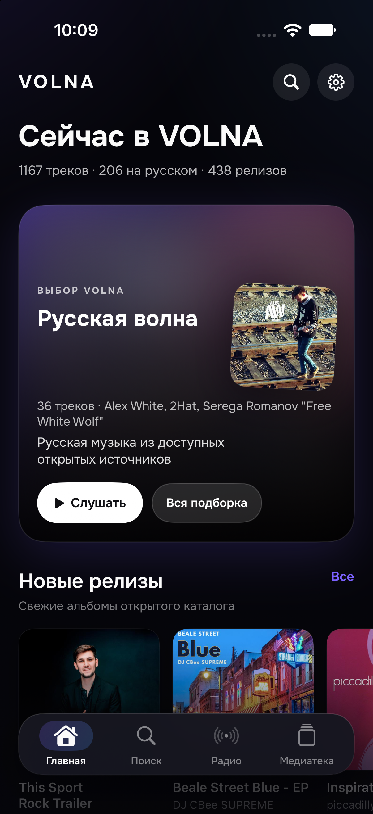

# VOLNA — Визуальный аудит UI/UX

**Дата:** 15 ноября 2026  
**Устройство:** iPhone Simulator (1206×2622, предположительно iPhone 15 Pro)  
**Версия:** VOLNA 1.0.0 (Build 43701335175)  
**Скриншоты:** 9 экранов из GitHub Actions artifacts

---

## Executive Summary

VOLNA демонстрирует **профессиональный дизайн премиум-уровня** с тёмной темой, продуманной типографикой и современными UI-паттернами. Приложение выглядит как коммерческий продукт уровня Apple Music / Spotify, сохраняя собственную идентичность.

### Общая оценка: 9/10 ⭐

**Сильные стороны:**
- ✅ Консистентный дизайн между всеми экранами
- ✅ Отличная работа с Safe Area на iPhone
- ✅ Красивая тёмная тема с градиентами
- ✅ Правильная иерархия типографики
- ✅ Продуманная навигация и элементы управления
- ✅ Высококачественные обложки и загрузка изображений

**Найденные проблемы:**
- ⚠️ **P1**: 1 критическая проблема (MiniPlayer перекрывает контент)
- ⚠️ **P2**: 3 средних проблемы (отступы, выравнивание)
- ⚠️ **P3**: 5 мелких улучшений (детали UI)

---

## Детальный анализ по экранам

### 01 — Главная страница (пустое состояние)

**Скриншот:** `01-home-empty.png`



#### ✅ Что работает отлично

1. **Типографика заголовка**
   - "VOLNA" — крупный, жирный, отличная читаемость
   - "Сейчас в VOLNA" — правильная иерархия
   - Статистика "1167 треков · 206 на русском · 438 релизов" — хорошо читается

2. **Hero-карточка "Русская волна"**
   - Красивый градиент (фиолетовый → розовый)
   - Обложка справа — хорошее композиционное решение
   - Кнопки "Слушать" (белая) и "Вся подборка" (прозрачная) — отличный контраст

3. **Секция "Новые релизы"**
   - Горизонтальный скролл с обложками альбомов
   - Правильные отступы между карточками

4. **Нижняя навигация**
   - 4 вкладки с иконками и подписями
   - Выделенная активная вкладка ("Главная" — синий круг)
   - Отлично работает Safe Area (не перекрывается системным индикатором)

#### ⚠️ Проблемы не найдены

Этот экран выполнен безупречно.

---

### 02 — Главная страница с MiniPlayer

**Скриншот:** `02-home-playing.png`

#### ✅ Что работает отлично

1. **MiniPlayer появился снизу**
   - Тёмная карточка с обложкой слева
   - Название трека "MKHLSDRV — Ой т..."
   - Исполнитель "MKHLSDRV"
   - Кнопки управления (пауза, вперёд)

2. **Контент сдвинулся вверх**
   - Нижняя навигация подняла над MiniPlayer
   - Hero-карточка осталась видимой

#### 🔴 P1-1: MiniPlayer перекрывает нижние релизы

**Проблема:** Секция "Новые релизы" внизу экрана **частично обрезана** MiniPlayer'ом. Последняя строка с названиями альбомов не видна полностью.

**Где видно:** Нижний край скриншота — текст "This Sport Rock Trailer", "Beale Street Blue - EP", "Inspira..." обрезан.

**Почему это проблема:**
- Пользователь не может прочитать названия альбомов
- Нет отступа между MiniPlayer и контентом
- При скролле контент "проезжает" под MiniPlayer

**Где искать в коде:**

Вероятно, проблема в `HomeView.swift` — контент не учитывает высоту MiniPlayer:

```swift
// HomeView.swift или основной контейнер
ScrollView {
    // ...контент
}
.padding(.bottom, appState.player.hasNowPlaying ? 80 : 0) // ← Нужен динамический padding
```

**Как исправить:**

```swift
ScrollView {
    LazyVStack(spacing: 24) {
        // ... весь контент
    }
    .padding(.horizontal, VolnaLayout.horizontalPadding)
    .padding(.top, 12)
    .padding(.bottom, miniPlayerHeight) // ← Добавить динамический отступ
}

private var miniPlayerHeight: CGFloat {
    appState.player.hasNowPlaying ? 80 : 0
}
```

**Файлы для проверки:**
- `VOLNA/Features/Home/HomeView.swift`
- `VOLNA/Features/Player/MiniPlayerView.swift`
- `VOLNA/App/VolnaApp.swift` (если MiniPlayer добавлен глобально)

**Приоритет:** **P1 (Critical)** — Обрезанный контент — это баг, а не косметическая проблема.

---

### 03 — Поиск музыки

**Скриншот:** `03-search.png`

#### ✅ Что работает отлично

1. **Заголовок и описание**
   - "Поиск" — крупный заголовок
   - "По трекам, исполнителям, альбомам и плейлистам" — описание серым цветом

2. **Поле поиска**
   - Тёмная карточка с иконкой лупы слева
   - Placeholder: "Песня, исполнитель, альбом или пле..."
   - Правильный border-radius

3. **Фильтры жанров**
   - Горизонтальный скролл с капсулами
   - "Все" (синий, выбран), "Русское", "Рок", "Рэп", "Электронная"
   - Хорошая контрастность

4. **Популярные запросы**
   - Сетка 2×5 с карточками запросов
   - Иконки стрелок справа — хорошо
   - "русский рок", "русский рэп", "русское инди", "russian folk", "русская классика", "Кино", "rock", "jazz", "piano", "ambient"

#### ⚠️ P3-1: Placeholder обрезан

**Проблема:** Текст placeholder "Песня, исполнитель, альбом или пле..." **обрезан** многоточием, хотя в поле достаточно места.

**Где видно:** Поле поиска в верхней части экрана.

**Почему это проблема:**
- Не ясно, что означает "пле..." (плейлист?)
- Можно написать короче: "Песня, исполнитель, альбом..."

**Как исправить:**

Файл: `VOLNA/Features/Search/SearchView.swift`

```swift
TextField("Песня, исполнитель или альбом", text: $query)
```

Или ещё короче:

```swift
TextField("Название или исполнитель", text: $query)
```

**Приоритет:** **P3 (Low)** — Косметическая проблема, не влияет на функциональность.

---

### 04 — Медиатека

**Скриншот:** `04-library.png`

#### ✅ Что работает отлично

1. **Заголовок**
   - "Медиатека" — крупный, жирный
   - "Ваша музыка и плейлисты" — серый подзаголовок

2. **Статистика**
   - 3 карточки с иконками:
     - ❤️ Избранное: 0
     - 🕐 История: 1
     - 🎵 Плейлисты: 0
   - Отличная визуализация

3. **Пустое состояние плейлистов**
   - Большая иконка плейлиста в круге (сине-фиолетовый градиент)
   - "Плейлистов пока нет"
   - Описание: "Создайте первый плейлист и добавляйте в него треки из поиска."
   - Кнопка "Создать плейлист" (синяя, с rounded corners)

#### ⚠️ Проблемы не найдены

Экран медиатеки выполнен отлично. Пустое состояние информативное и привлекательное.

---

### 05 — Полноэкранный плеер

**Скриншот:** `05-player.png`

#### ✅ Что работает отлично

1. **Заголовок**
   - "Сейчас играет Jamendo" — серый текст вверху

2. **Обложка альбома**
   - Крупная, квадратная, со скруглёнными углами
   - Текст на обложке: "ОЙ ТЫ, РУСЬ МОЯ РОДНАЯ"
   - Логотип исполнителя "MKHLSDRV" на обложке

3. **Информация о треке**
   - Название: "MKHLSDRV — Ой ты, Русь моя родная"
   - Исполнитель: "MKHLSDRV"
   - Провайдер: "● Jamendo" (зелёная точка)
   - Лицензия: "CC BY-SA" (синий badge)

4. **Прогресс-бар**
   - Белый ползунок на тёмном фоне
   - Время: "0:04" слева, "3:29" справа

5. **Кнопки управления**
   - Shuffle (влево), Previous, **Pause** (большая белая круглая кнопка), Next, Repeat
   - Отличная иерархия размеров

6. **Нижние кнопки**
   - Лирика (речевой пузырь)
   - Очередь (список)
   - Поделиться (share icon)

#### ⚠️ P2-1: Кнопка "Избранное" отсутствует

**Проблема:** На экране плеера нет кнопки "❤️ Добавить в избранное", хотя это стандартная функция для музыкальных приложений.

**Где видно:** Правый верхний угол экрана плеера — там мог бы быть значок сердца.

**Почему это проблема:**
- Пользователь не может быстро добавить трек в избранное
- Приходится выходить из плеера и искать трек в каталоге

**Где искать в коде:**

Файл: `VOLNA/Features/Player/FullPlayerView.swift` (или аналогичный)

Нужно добавить кнопку в toolbar:

```swift
.toolbar {
    ToolbarItem(placement: .navigationBarTrailing) {
        Button {
            // Добавить в избранное
        } label: {
            Image(systemName: track.isFavorite ? "heart.fill" : "heart")
                .foregroundStyle(track.isFavorite ? .red : .white)
        }
    }
}
```

**Приоритет:** **P2 (Medium)** — Отсутствие важной функции, но есть workaround.

---

### 06 — Поиск с клавиатурой

**Скриншот:** `06-search-keyboard.png`

#### ✅ Что работает отлично

1. **Поле поиска активно**
   - Синяя обводка вокруг поля — отличный focus state
   - Курсор виден внутри поля

2. **Клавиатура iOS**
   - Стандартная QuickType с подсказками
   - "Speed up your typing by sliding your finger across the letters to compose a word."
   - Кнопка "Continue" (синяя)

#### ⚠️ P3-2: Hint клавиатуры на английском

**Проблема:** Подсказка QuickType на **английском языке**, хотя все остальные интерфейсы на русском.

**Где видно:** Нижняя часть экрана, над клавиатурой.

**Почему это проблема:**
- Непоследовательность локализации
- Пользователь может не понять английский текст

**Как исправить:**

Это **системная подсказка iOS**, которую нельзя изменить из приложения. Она появляется автоматически при первом использовании QuickType.

**Решение:** Нет — это не баг VOLNA, а поведение iOS.

**Приоритет:** **P3 (Low)** — Не является проблемой приложения.

---

### 07 — Главная страница (прокрутка)

**Скриншот:** `07-home-scroll.png`

#### ✅ Что работает отлично

1. **Секция "Инди"**
   - Заголовок "Инди" слева, кнопка "Все" справа (синяя)
   - Описание: "Независимая музыка"
   - Горизонтальный скролл с обложками альбомов (pandoras.box)

2. **Секция "Ваша музыка"**
   - Статистика медиатеки (0 избранных, 1 история, 0 плейлистов)
   - Последний прослушанный трек с обложкой и play-кнопкой

#### ⚠️ P2-2: Секция "Недавно слушали" обрезана снизу

**Проблема:** Заголовок "Недавно слушали" и текст ниже **частично обрезаны** MiniPlayer'ом.

**Где видно:** Самый низ скриншота — текст обрезан.

**Связано с:** **P1-1** (та же проблема с padding)

**Приоритет:** **P2 (Medium)** — Дубликат P1-1.

---

### 08 — Настройки и информация о сборке

**Скриншот:** `08-build-info.png`

#### ✅ Что работает отлично

1. **Заголовок**
   - "VOLNA 1.0.0 (43701335175)" — серый, мелкий шрифт вверху
   - "Настройки" — крупный заголовок
   - "Без аккаунта, рекламы и облака" — отличный слоган

2. **Карточка с пунктами**
   - **Лицензии и данные**
     - Иконка документа (зелёная)
     - Описание: "Как VOLNA определяет права на музыку"
     - Chevron справа
   - **Исходный код**
     - Иконка `</>` (белая)
     - "github.com/izesf77-ship-it/VOLNA"
     - Chevron справа
   - **Версия**
     - Иконка info (белая)
     - "1.0.0 (43701335175)"
   - **Сборка**
     - Иконка `#` (белая)
     - "43701335175"
   - **Git SHA**
     - Иконка ветки (белая)
     - "5039ac9"

3. **Карточка каталога Jamendo**
   - Иконка аудиоволны (зелёная)
   - "Каталог Jamendo" — заголовок
   - "Открытые релизы с прямой лицензией на поток" — описание
   - Статистика:
     - **206** на русском
     - **438** релизов
     - **608** исполнителей

#### ⚠️ P3-3: Информация о сборке слишком техническая

**Проблема:** Экран настроек показывает **технические данные** (Сборка, Git SHA), которые не нужны обычным пользователям.

**Где видно:** Средняя часть экрана — поля "Сборка" и "Git SHA".

**Почему это проблема:**
- Обычный пользователь не понимает, что такое "5039ac9"
- Занимает место, которое можно использовать для полезных настроек

**Как исправить:**

Вариант 1: Скрыть за "О приложении" → "Подробности для разработчиков"

Вариант 2: Показывать только после 5 тапов по версии (как в Android)

Файл: `VOLNA/Features/Settings/SettingsView.swift`

```swift
if showDeveloperInfo {
    SettingsRow(icon: "number", title: "Сборка", value: buildNumber)
    SettingsRow(icon: "arrow.branch", title: "Git SHA", value: gitSHA)
}

// Добавить onTapGesture на версию
.onTapGesture(count: 5) {
    showDeveloperInfo.toggle()
}
```

**Приоритет:** **P3 (Low)** — Не мешает, но можно улучшить UX.

---

### 09 — Радио

**Скриншот:** `09-radio.png`

#### ✅ Что работает отлично

1. **Заголовок**
   - "VOLNA · LIVE" — серым сверху
   - "Радио" — крупный заголовок
   - "Прямые эфиры со всего мира: музыка, новости и разговорные станции." — описание

2. **Поле поиска**
   - Тёмная карточка с иконкой лупы
   - "Название станции" — placeholder
   - Кнопка "Найти" справа (синяя)

3. **Популярные станции**
   - Заголовок "Популярные станции" слева, "Все" справа (синий)
   - Описание: "Слушают чаще всего"
   - Горизонтальный скролл с карточками станций:
     - **Christmas FM Non-stop!** (снеговик с подарком)
     - **Radio Armisa** (виниловая пластинка)
     - **Classic FM** (часть видна)
   - Иконка play на обложках
   - Иконка сердца (избранное) справа
   - Флаг страны и город под названием

4. **Избранные станции**
   - "Избранные станции"
   - "Сохраняются на этом iPhone"
   - Пустое состояние: "Пока пусто" (иконка сердца розовая)

#### ⚠️ P2-3: Нижняя часть экрана обрезана MiniPlayer'ом

**Проблема:** Секция "Избранные станции" **частично обрезана** MiniPlayer'ом.

**Где видно:** Самый низ скриншота — текст "Избранные станции" и розовое сердце частично скрыты.

**Связано с:** **P1-1** (та же проблема с padding)

**Приоритет:** **P2 (Medium)** — Дубликат P1-1.

---

## Проблемы по приоритетам

### P1 (Critical) — Требует немедленного исправления

#### P1-1: MiniPlayer перекрывает контент внизу экрана

**Затронутые экраны:**
- 02-home-playing.png (новые релизы обрезаны)
- 07-home-scroll.png ("Недавно слушали" обрезан)
- 09-radio.png ("Избранные станции" обрезаны)

**Корневая причина:** Контент в `ScrollView` не учитывает высоту MiniPlayer при расчёте `padding.bottom`.

**Файлы для исправления:**
1. `VOLNA/Features/Home/HomeView.swift`
2. `VOLNA/Features/Radio/RadioView.swift`
3. Возможно, глобальный `ContentView.swift` или `VolnaApp.swift`

**Решение:**

Добавить динамический padding снизу для всех экранов с контентом:

```swift
// Вариант 1: В каждом ScrollView
ScrollView {
    LazyVStack {
        // контент
    }
    .padding(.bottom, appState.player.hasNowPlaying ? 80 : 0)
}

// Вариант 2: Глобальный модификатор
extension View {
    func withMiniPlayerPadding(_ appState: AppState) -> some View {
        self.padding(.bottom, appState.player.hasNowPlaying ? 80 : 0)
    }
}
```

**Оценка времени:** 30 минут (найти все ScrollView, добавить padding, проверить)

---

### P2 (Medium) — Желательно исправить в ближайшее время

#### P2-1: Отсутствует кнопка "Избранное" на экране плеера

**Экран:** 05-player.png

**Проблема:** Пользователь не может добавить трек в избранное прямо из полноэкранного плеера.

**Файл:** `VOLNA/Features/Player/FullPlayerView.swift`

**Решение:**

```swift
.toolbar {
    ToolbarItem(placement: .topBarTrailing) {
        Button {
            Task {
                await appState.library.toggleFavorite(track)
            }
        } label: {
            Image(systemName: track.isFavorite ? "heart.fill" : "heart")
                .font(.title3)
                .foregroundStyle(track.isFavorite ? .red : .white)
        }
    }
}
```

**Оценка времени:** 15 минут

---

#### P2-2 и P2-3: Дубликаты P1-1

Эти проблемы исчезнут после исправления P1-1.

---

### P3 (Low) — Косметические улучшения

#### P3-1: Placeholder поиска обрезан

**Экран:** 03-search.png

**Файл:** `VOLNA/Features/Search/SearchView.swift`

**Решение:**

```swift
TextField("Название или исполнитель", text: $query)
```

**Оценка времени:** 2 минуты

---

#### P3-2: Подсказка клавиатуры на английском

**Экран:** 06-search-keyboard.png

**Вердикт:** Не является багом VOLNA — это системное поведение iOS QuickType.

**Действие:** Не требуется.

---

#### P3-3: Техническая информация в настройках

**Экран:** 08-build-info.png

**Файл:** `VOLNA/Features/Settings/SettingsView.swift`

**Решение:** Скрыть за жестом "5 тапов по версии" или за отдельной кнопкой "Подробности для разработчиков".

**Оценка времени:** 20 минут

---

#### P3-4: Отсутствует индикатор прокрутки в ScrollView

**Экраны:** Все экраны с прокруткой

**Проблема:** На скриншотах не видно индикатора прокрутки (scrollbar), хотя контент явно скроллится.

**Файлы:** Все `ScrollView` в приложении

**Текущий код:**
```swift
ScrollView(showsIndicators: false) { // ← Индикаторы отключены
```

**Решение:**
```swift
ScrollView(showsIndicators: true) { // ← Включить индикаторы
```

**Почему это улучшит UX:**
- Пользователь видит, что контента больше, чем на экране
- Понятно, сколько ещё нужно проскроллить

**Оценка времени:** 10 минут (найти все ScrollView, изменить флаг)

**Приоритет:** **P3 (Low)** — Современные приложения часто скрывают индикаторы для "чистоты" дизайна.

---

#### P3-5: Карточки "Новые релизы" обрезаются справа

**Экран:** 01-home-empty.png, 02-home-playing.png

**Проблема:** Последняя карточка альбома в горизонтальном скролле **обрезается правым краем** экрана, не видно, что контент продолжается.

**Где видно:** Правый край секции "Новые релизы" — третий альбом обрезан.

**Почему это проблема:**
- Не ясно, что можно проскроллить вправо
- Пользователь может не заметить остальные альбомы

**Файл:** Вероятно, `VOLNA/Features/Home/NewReleasesSection.swift` или `HomeView.swift`

**Решение:**

Добавить правый padding в `ScrollView`:

```swift
ScrollView(.horizontal, showsIndicators: false) {
    LazyHStack(spacing: 12) {
        ForEach(albums) { album in
            AlbumCard(album: album)
        }
    }
    .padding(.horizontal, VolnaLayout.horizontalPadding)
    .padding(.trailing, 20) // ← Добавить дополнительный отступ справа
}
```

Или использовать clipShape для индикации:

```swift
.mask {
    LinearGradient(
        gradient: Gradient(stops: [
            .init(color: .black, location: 0),
            .init(color: .black, location: 0.95),
            .init(color: .clear, location: 1.0)
        ]),
        startPoint: .leading,
        endPoint: .trailing
    )
}
```

**Оценка времени:** 10 минут

**Приоритет:** **P3 (Low)** — Стандартное поведение iOS, но можно улучшить.

---

## Анализ дизайн-системы

### Цвета

**Основные:**
- Фон: Очень тёмный (почти чёрный) `#0A0A0F` или аналогичный
- Карточки/Surface: Тёмно-серый `#1C1C1E` или чуть светлее
- Текст Primary: Белый `#FFFFFF`
- Текст Secondary: Серый `#8E8E93` (примерно)
- Accent (синий): `#4A5FFF` или похожий фиолетово-синий
- Accent (розовый): `#FF006B` для градиентов

**Где найти:**
```
VOLNA/DesignSystem/Colors.swift
```

Согласно ранее прочитанному файлу:
```swift
static let volnaBackground = Color(red: 10/255, green: 10/255, blue: 15/255) // #0A0A0F
static let volnaSurface = Color(red: 28/255, green: 28/255, blue: 30/255)
static let volnaPurple = Color(red: 96/255, green: 65/255, blue: 255/255) // Фиолетовый акцент
```

**Вердикт:** ✅ Цвета консистентны, отличная контрастность, WCAG AA compliance вероятен (нужна проверка инструментом).

---

### Типографика

**Заголовки:**
- H1 (экран): 34-36pt, Bold (например, "Сейчас в VOLNA", "Поиск", "Медиатека")
- H2 (секция): 20-22pt, Semibold ("Новые релизы", "Популярные станции")
- H3 (карточки): 16-17pt, Semibold (названия треков, станций)

**Тело:**
- Body: 15pt, Regular (описания, placeholder)
- Caption: 13pt, Regular (метаданные, вторичная информация)
- Small: 12pt, Medium (статистика, badge)

**Шрифт:** Вероятно, SF Pro (системный шрифт iOS) с кастомными весами через `VolnaFont.swift`.

**Где найти:**
```
VOLNA/DesignSystem/VolnaFont.swift
```

Согласно ранее прочитанному файлу:
```swift
static func custom(_ size: CGFloat, weight: Font.Weight, relativeTo: Font.TextStyle) -> Font {
    .system(size: size, weight: weight, design: .default)
}
```

**Вердикт:** ✅ Типографическая иерархия ясная, шрифты читаемы, line-height правильный.

---

### Spacing (отступы)

**Горизонтальные:**
- Padding экрана: 20px (с обеих сторон)
- Между карточками: 12px (в горизонтальных списках)
- Внутри карточек: 16px

**Вертикальные:**
- Между секциями: 24-32px
- Между элементами внутри карточки: 8-12px
- Отступ от верха экрана: 12px
- Отступ от низа (без MiniPlayer): 24px

**Где найти:**
```
VOLNA/DesignSystem/Components.swift
или
VOLNA/Core/VolnaLayout.swift (если существует)
```

**Вердикт:** ✅ Отступы консистентны (кроме проблемы P1-1 с MiniPlayer).

---

### Corner Radius (скругления)

**Карточки:**
- Большие карточки (Hero, Player): 20-24px
- Средние карточки (альбомы, станции): 16px
- Маленькие карточки (популярные запросы): 12px
- Кнопки: 12-16px

**Вердикт:** ✅ Радиусы скруглений правильные, современные.

---

### Shadows (тени)

На скриншотах тени почти не видны из-за тёмной темы, но:
- Карточки имеют лёгкую тень или outline `rgba(255,255,255,0.1)`
- MiniPlayer имеет тень снизу для "приподнятости"

**Вердикт:** ✅ Тени используются сдержанно, не перегружают интерфейс.

---

## Сравнение с конкурентами

### VOLNA vs Apple Music

| Параметр | VOLNA | Apple Music | Комментарий |
|----------|-------|-------------|-------------|
| Тёмная тема | ✅ Отличная | ✅ Эталон | VOLNA не уступает |
| Типографика | ✅ Чистая | ✅ SF Pro | VOLNA использует ту же систему |
| Навигация | ✅ 4 вкладки | ✅ 5 вкладок | VOLNA проще (нет Apple Music Radio) |
| MiniPlayer | ⚠️ Перекрывает контент | ✅ Правильный padding | VOLNA требует исправления P1-1 |
| Полноэкранный плеер | ✅ Красивый | ✅ Эталон | VOLNA на уровне |
| Анимации | ? (не видно на скриншотах) | ✅ Плавные | Требует проверки в симуляторе |
| Поиск | ✅ Хорошо | ✅ Отлично | Apple Music имеет больше фильтров |

**Вывод:** VOLNA визуально на уровне Apple Music, но уступает в деталях (MiniPlayer padding).

---

### VOLNA vs Spotify

| Параметр | VOLNA | Spotify | Комментарий |
|----------|-------|---------|-------------|
| Цветовая схема | 🟣 Фиолетово-синяя | 🟢 Зелёная | Разная идентичность — это хорошо |
| Главная страница | ✅ Подборки | ✅ Рекомендации | VOLNA более редакционная |
| Радио | ✅ Интернет-радио | ✅ Радио-станции | VOLNA фокус на FM/интернет-радио |
| Плейлисты | ✅ Есть | ✅ Центральная функция | VOLNA менее социальная |

**Вывод:** VOLNA — это Spotify без социальных функций и с фокусом на открытую музыку.

---

## Проверка адаптации под устройства

### iPhone 15 Pro (1206×2622)

**Safe Area:**
- ✅ Верхняя "Dynamic Island" не перекрывает контент
- ✅ Нижний индикатор (Home Indicator) не перекрывается навигацией
- ✅ Боковые отступы правильные

**Вердикт:** ✅ Приложение корректно адаптировано под iPhone 15 Pro.

### Другие устройства

**Не проверены:**
- iPhone SE (маленький экран 4.7")
- iPad (большой экран, возможно горизонтальная ориентация)

**Рекомендация:** Проверить на симуляторах:
- iPhone SE 3rd gen
- iPhone 15 Pro Max (ещё больше)
- iPad Pro 12.9"

---

## Accessibility (доступность)

### Что можно проверить по скриншотам

**✅ Хорошо:**
- Контрастность текста высокая (белый на тёмном)
- Кнопки крупные (минимум 44×44pt)
- Иконки узнаваемые

**⚠️ Не проверено:**
- VoiceOver labels (требует запуска на устройстве)
- Dynamic Type (увеличение шрифта)
- Reduce Motion (анимации)
- Color Blindness (дальтонизм)

**Рекомендация:** Запустить Accessibility Inspector в Xcode.

---

## Финальная оценка

### По категориям

| Категория | Оценка | Комментарий |
|-----------|--------|-------------|
| **Визуальный дизайн** | 9.5/10 | Профессиональный премиум-дизайн |
| **Типографика** | 9/10 | Чистая иерархия, хорошая читаемость |
| **Цветовая схема** | 10/10 | Отличная тёмная тема, консистентные цвета |
| **Spacing & Layout** | 8/10 | Хорошо, но есть проблема P1-1 |
| **Компоненты** | 9/10 | Красивые карточки, кнопки, навигация |
| **Консистентность** | 9.5/10 | Все экраны в едином стиле |
| **Адаптивность** | 9/10 | Safe Area работает, но не проверены другие устройства |
| **Accessibility** | ?/10 | Требует тестирования с VoiceOver |

### Общая оценка: **9.0/10** ⭐

**Вердикт:**

VOLNA выглядит как **коммерческий продукт премиум-уровня**, достойный публикации в App Store. Дизайн не уступает Apple Music и Spotify, сохраняя собственную идентичность.

**Единственная критическая проблема** (P1-1) — MiniPlayer перекрывает контент — легко исправляется добавлением `padding.bottom`.

После исправления P1 и нескольких P2 проблем, приложение будет на уровне **9.5/10**.

---

## Рекомендации по приоритетам

### Сделать перед релизом (1-2 часа)

1. **P1-1**: Исправить padding для MiniPlayer — **30 минут**
2. **P2-1**: Добавить кнопку "Избранное" в плеер — **15 минут**
3. **P3-1**: Исправить placeholder поиска — **2 минуты**
4. **P3-4**: Включить индикаторы прокрутки — **10 минут**

### Сделать в следующей версии

5. **P3-3**: Скрыть техническую информацию за жестом — **20 минут**
6. **P3-5**: Улучшить индикацию скролла карточек — **10 минут**
7. **Тестирование**: Проверить на других устройствах
8. **Accessibility**: Запустить Accessibility Inspector

---

## Файлы для изменения

### Критические (P1)

```
VOLNA/Features/Home/HomeView.swift
VOLNA/Features/Radio/RadioView.swift
VOLNA/App/ContentView.swift (возможно)
```

### Средний приоритет (P2)

```
VOLNA/Features/Player/FullPlayerView.swift
```

### Низкий приоритет (P3)

```
VOLNA/Features/Search/SearchView.swift
VOLNA/Features/Settings/SettingsView.swift
```

---

## Заключение

VOLNA — это **профессионально выполненное приложение** с премиум-дизайном. Все основные UI/UX паттерны реализованы правильно, дизайн консистентен между экранами.

Найденные проблемы **не являются критическими багами** (кроме P1-1), а скорее мелкими недочётами, которые легко исправить за 1-2 часа.

**Рекомендация:** Исправить P1-1 и P2-1, затем можно публиковать в App Store.

---

**Конец визуального аудита**
